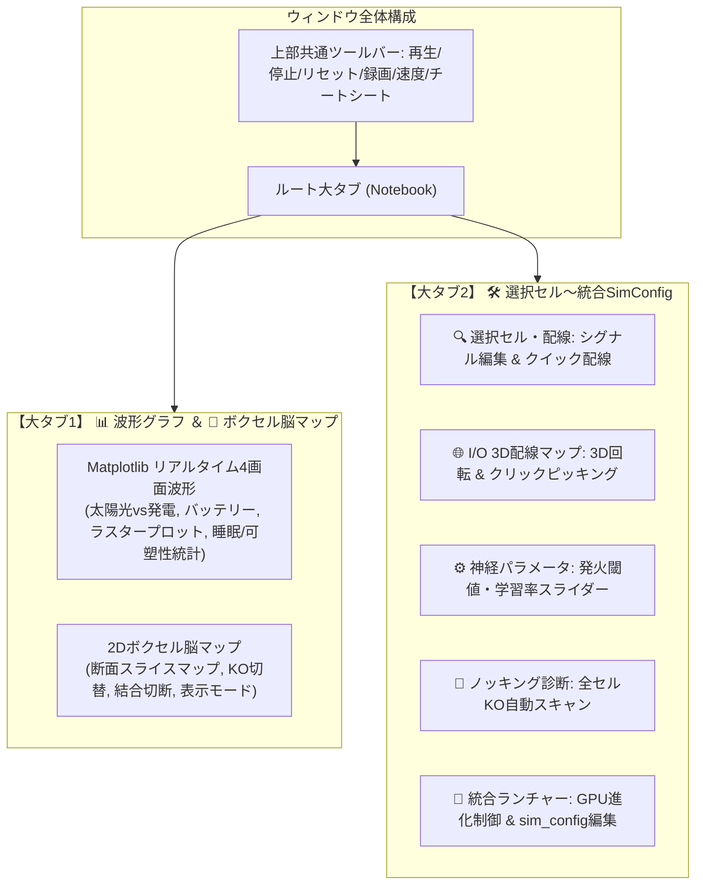

# VoxelBrain (Rev. 6.0) 技術仕様・アーキテクチャ解説書
## 3D格子結合写像非平衡散逸神経力学系 ＆ 生涯学習・進化計算統合システム

---

## 1. 基本設計思想

* **力学系による自律的知能**:  
  大域的な逆伝播最適化器（Backpropagation）や全結合アテンションを用いず、3D空間内の局所相互作用に基づく結合写像格子（Coupled Map Lattice: CML）を構成し、時空カオスと散逸構造から適応行動を創発させる。
* **直交基底シグネチャ内積による結合自律決定**:  
  各セルに割り当てられた多次元シグネチャ（$\mathrm{sig\_pre}, \mathrm{sig\_post} \in \mathbb{R}^4$）の内積からシナプス初期結合強度を自律的に決定する。局所幾何（27近傍）と遠隔ショートカット（1本）が同一の数理で生成される。
* **非対称生体膜受肉（Asymmetric Embodiment）**:  
  内部ニューロン空間（$N$ 空間: $0 \sim N-1$）と、それを取り囲む外周感覚膜（$P$ 空間: $-1 \sim N$）を分離。感覚入力は外周膜へ注入され、運動出力は内部表面ニューロンから環境へ読み出される。
* **自律エネルギー代謝力学**:  
  太陽光サイクル環境下で代謝コストと発電コストを支払いながら活動する。エネルギーが尽きると個体は餓死（生存スコア確定）となる過酷な淘汰圧の中で生存回路を進化させる。
* **生涯学習と睡眠による記憶選別（Plasticity & Sleep Consolidation）**:  
  覚醒時はシナプスタグ（Eligibility Trace）と大域ドーパミンによる三要素学習で適応し、睡眠時は活動を鎮静化させながら双安定アトラクタにより有用な記憶を結晶化・ノイズを剪定する。

---

## 2. ゲノム構造およびデータモデル（Structure of Arrays）

GPU のメモリトランザクション（128 Byte境界）および超並列変異・進化計算に最適化した SoA（Structure of Arrays）バッファで個体を構成します。

### 2.1 空間スケール
* **次元数（`DIM`）**:  
  - `DIM = 1`: $2 \times 2 \times 2 = 8$ セル
  - `DIM = 2`: $4 \times 4 \times 4 = 64$ セル
  - `DIM = 3`: $8 \times 8 \times 8 = 512$ セル
* **内部格子（$N$ 空間）**: $N = 2^{\mathrm{DIM}}$ （各軸 $0 \sim N-1$）
* **膜込み格子（$P$ 空間）**: $P = N + 2$ （各軸 $-1 \sim N$、配列インデックス $0 \sim P-1$）

### 2.2 個体ゲノム・メモリマップ
1個体あたり以下のフラットバッファで完全定義され、GPU VRAM上に常駐して並列進化・シミュレーションされます。

```cpp
// 1個体あたりのゲノム構成
struct IndividualGenome {
    half4  sig_pre[TOTAL_NP2];     // 出力側シグネチャ (Np2空間, 4チャネル)
    half4  sig_post[TOTAL_NP2];    // 入力側シグネチャ (Np2空間, 4チャネル)
    half   dopamine_map[TOTAL_N];  // ドーパミン分泌核度マップ (0.0 ~ 1.0)
    half   sleep_map[TOTAL_N];     // 睡眠中枢度マップ (0.0 ~ 1.0)
    uint32 inhib_bits[INHIB_STRIDE]; // 抑制性(-1)/興奮性(+1)ビットマップ

    // 固定長スロット入出力ポート設定 (面番号, u, v)
    int3   in_ports_fi[NUM_IN_PORTS];   // 感覚入力ポート (外周膜6面)
    int3   out_ports_fi[NUM_OUT_PORTS]; // 運動出力ポート (内部表面6面)

    // 神経ダイナミクスパラメータ
    half   base_output;        // 基本放出速度 k0
    half   beta;               // シグモイド感度ゲイン
    half   k_refill;           // 小胞資源再充填率
    uint   bias, multiplier;   // 28番目長距離結合算出パラメータ

    // 生涯学習パラメータ
    half   learning_rate;      // 双安定結晶化速度 λ
    half   forget_rate;        // 学習率・忘却率 η
    half   learning_threshold; // 記憶維持/剪定閾値 θ (標準: 0.5)
    half   tag_decay;          // シナプスタグ減衰率
};
```

---

## 3. 神経核ダイナミクスと内生体積伝達

### 3.1 シナプス結合重みの決定
シナプス後セル $i$ と前セル $j$ の結合重み $W_{ij} \in [0.0, 1.0]$ は、それぞれの直交基底シグネチャの内積によって分岐なしで算出されます。

$$W_{ij} = \mathrm{saturate}\left( 0.25 \cdot \left( \mathbf{sig\_post}_i \cdot \mathbf{sig\_pre}_j \right) \right)$$

* 局所27近傍（$3 \times 3 \times 3$）および長距離ショートカット結合（第28結合: `(groupIndex * multiplier + bias) % TOTAL_N`）の全てに適用。

### 3.2 単一アレニウス速度論と小胞資源モデル
不応期、感度調整、誘発放出、および自発放出を単一の反応速度論で処理します。

1. **放出速度（`rate`）**:
   膜電位入力 $\mathrm{net}_i$ に応じてエネルギー障壁が線形変調されます（GPU の `exp2` 命令を活用）。
   $$\mathrm{rate}_i = k_0 \cdot \exp_2\left( \mathrm{net}_i \cdot \beta \right)$$

2. **小胞資源（$R$）の充填・放出平衡**:
   利用可能資源 $R_i \in [0.0, 1.0]$ は消費と充填の差分方程式に従います。睡眠係数 $a$ により放出流束が動的に変調されます。
   $$v_{\mathrm{release}, i} = a \cdot (\mathrm{rate}_i \cdot R_i)$$
   $$v_{\mathrm{refill}, i} = k_{\mathrm{refill}} \cdot (1.0 - R_i)$$
   $$R_i \leftarrow \mathrm{saturate}\left( R_i + (v_{\mathrm{refill}, i} - v_{\mathrm{release}, i}) \right)$$

3. **入力統合（質量作用の法則）**:
   $$\mathrm{net}_i = \sum_{j=1}^{28} \mathrm{Sign}_j \cdot W_{ij} \cdot \mathrm{output}_j$$
   * $\mathrm{Sign}_j \in \{-1.0, +1.0\}$: `inhib_bits` により決定される興奮性/抑制性符号。

### 3.3 並列リダクションによる内生体積伝達
アトミック命令や排他ロックを排し、Warp Shuffle 命令（`WaveActiveSum`）と共有メモリプールを用いた2段階リダクションにより、$O(\log N)$ の一定レイテンシで全脳のドーパミン総量と睡眠抑制係数を集約・ブロードキャストします。

* **大域ドーパミン分泌量**:
  $$\mathrm{my\_dopamine\_sum} = \left( \sum_{i=1}^{\mathrm{TOTAL\_N}} |\mathrm{output}_i| \cdot \mathrm{dopamine\_map}_i \right) \cdot \mathrm{ENABLE\_DOPAMINE}$$
* **大域睡眠係数（$a$）**:
  $$S = \mathrm{saturate}\left( \sum_{i=1}^{\mathrm{TOTAL\_N}} |\mathrm{output}_i| \cdot \mathrm{sleep\_map}_i \right) \cdot \mathrm{ENABLE\_SLEEP}$$
  $$a = 1.0 - S \quad (a \in [0.0, 1.0])$$

---

## 4. 生涯学習キネティクス（Eligibility Trace ＆ 立方双安定記憶結晶化）

ヘッブ型相関タグ（Eligibility Trace）と大域ドーパミン、および睡眠時の双安定相転移を融合した強化学習・記憶定着システムです。

### 4.1 学習方程式
各シナプス結合 $W_{ij}$ は以下の式に従ってリアルタイムに更新されます：

$$\mathrm{tag}_{ij} \leftarrow \mathrm{saturate}\left( (\mathrm{tag}_{ij} + |\Delta \mathrm{net}_{ij}|) \cdot (1.0 - \mathrm{tag\_decay}) \right)$$

$$\Delta W_{ij} = \mathrm{ENABLE\_LEARNING} \cdot \mathrm{forget\_rate} \cdot \left[ \mathrm{my\_dopamine\_sum} \cdot \mathrm{tag}_{ij} + \mathrm{learning\_rate} \cdot f(W_{ij}) \right]$$

$$W_{ij} \leftarrow \mathrm{clamp}(W_{ij} + \Delta W_{ij}, 0.0, 1.0)$$

### 4.2 立方双安定項 $f(W)$ と睡眠選別（SHY仮説）
$$f(W) = W (1.0 - W) (W - \theta)$$

* **覚醒時（活動大、ドーパミン存在）**:  
  第1項（ドーパミン $\times$ タグ）が支配的となり、行動報酬と相関したシナプスが急速に強化されます。
* **睡眠時（活動鎮静 $a \to 0$、ドーパミン静態化）**:  
  第2項（双安定項 $f(W)$）のみが支配的となります：
  - **強固な結合（$W > \theta$）**: $f(W) > 0$ となり、睡眠中に **$W \to 1.0$ へ自律的に引き上げられ、記憶が結晶化（Consolidation）** されます。
  - **ノイズ結合（$W < \theta$）**: $f(W) < 0$ となり、睡眠中に **$W \to 0.0$ へ削ぎ落とされ、完全に剪定（Pruning）** されます。

---

## 5. 環境力学と固定長スロット入出力（I/O Architecture）

感覚入力と運動出力は、`sim_config.py` で指定された固定長スロット配列（`NUM_IN_PORTS`, `NUM_OUT_PORTS`）により柔軟に管理されます。

### 5.1 非対称幾何マッピング
* **感覚入力ポート（In: `in_ports_fi`）**:
  - 外周膜（$P$ 空間: $-1 \sim N$）の6面に配置。
  - スロット0: ☀️ 太陽光受光面（環境光 $Sun(t)$ を膜セルへ注入）
  - スロット1: ⚡ 蓄電量センサー面（現在エネルギー $E(t)$ を膜セルへ注入）
  - スロット2以降: 拡張センサー入力
* **運動出力ポート（Out: `out_ports_fi`）**:
  - 内部表面（$N$ 空間: $0 \sim N-1$）の6面に配置。
  - スロット0: ⚙️ 発電正極（$Gen+$）ニューロン
  - スロット1: ⚙️ 発電負極（$Gen-$）ニューロン
  - スロット2以降: 拡張アクチュエータ出力

### 5.2 太陽光サイクルと代謝・発電エネルギー収支
環境は周期的な昼夜サイクルを持ち、Thread 0 が毎ステップ以下を計算します：

1. **太陽光環境値**:
   $$Sun(t) = \mathrm{saturate}\left( \sin\left( \pi \cdot \frac{t \pmod{\mathrm{PERIOD}}}{\mathrm{PERIOD}} \right) \right)$$
2. **発電量**:
   $$\mathrm{gen\_raw} = \mathrm{output}_{Gen+} - \mathrm{output}_{Gen-}$$
3. **エネルギー収支更新**:
   $$E(t+1) = E(t) - \mathrm{METABOLIC\_COST} - |\mathrm{gen\_raw}| \cdot \mathrm{GEN\_COST\_RATE} + \max(0, \mathrm{gen\_raw}) \cdot Sun(t) \cdot \mathrm{SOLAR\_GAIN\_RATE}$$
4. **飢餓判定**:
   $E(t) \le 0.0$ に達した個体は即座に餓死（全ニューロン活動停止、生存ステップ数が生存スコアとして確定）となります。

---

## 6. GPU 超並列進化エンジン（`voxelBrain.py` & `mutation.slang`）

Slang シェーダーと Direct3D 12 コンピュートパイプラインを活用し、数万体規模のニューラルネットワークを同時にシミュレーション・変異・選択します。

### 6.1 多系統エリート保存・配分アルゴリズム
局所解トラップを防ぐため、以下の配分戦略で次世代集団を生成します：
1. **全個体最良エリート（Grand Champion）**: 突然変異なしで次世代に無傷で保存。
2. **多系統エリート枠（Lineage Elites）**: 異なる親系統の上位個体を保存し、多様性を維持。
3. **エリート子孫枠（Mutated Offspring）**: エリート個体にガウス微小変異を加えて大量生成。
4. **完全ランダム探索枠（Fresh Exploration）**: 定期的に完全ランダム個体を注入し、大域的探索を促進。

### 6.2 変異カーネル（`mutation.slang`）
`[unroll]` ループ展開により、全シグネチャ（`sig_pre`/`sig_post`）、核度マップ（`dopamine`/`sleep`）、興奮/抑制ビット（`inhib_bits`）、および入出力ポート配置（`in_ports_fi`/`out_ports_fi`）を GPU 上で一括確率変異させます。

---

## 7. 統合スタジオ GUI（`oneSim.py`）

進化した個体の内部活動、シナプス結合、可塑性キネティクスをリアルタイムに観察・編集・診断するための統合 GUI アプリケーションです。



### 7.1 主なスタジオ機能
- **広々とした2大タブ構成**: 波形解析画面と詳細設定画面を分離し、視認性を最大化。
- **インタラクティブ 3D 配線マップ**: マウス左ドラッグでボクセルキューブを 360° 回転させ、表面セルをクリックするだけで感覚受光面や運動出力先の配線を直感的に変更可能。
- **リアルタイム機能トグル**: シミュレーションを走らせたまま <kbd>L</kbd>（学習）、<kbd>D</kbd>（ドーパミン）、<kbd>S</kbd>（睡眠）を押して挙動変化を即座に実験。
- **ノッキング自動診断**: 全ニューロンを1つずつ破壊して発電効率への影響度をスコアリングし、重要ニューロンを自動特定。
- **完全チートシート内蔵**: <kbd>?</kbd> または <kbd>H</kbd> キーでいつでも操作一覧をポップアップ表示。

---

## 8. プロジェクト構成とクイックスタート

### 8.1 ファイル構成
| ファイル | 役割 |
| :--- | :--- |
| **`sim_config.py`** | 共通実行時設定（ポート数、学習/ドーパミン/睡眠フラグ、エネルギー代謝定数） |
| **`reasoningSim.slang`** | GPU 神経ダイナミクス・シミュレーション・コンピュートシェーダー |
| **`mutation.slang`** | GPU 並列突然変異コンピュートシェーダー |
| **`voxelBrain.py`** | GPU 進化計算メインエンジン（Direct3D 12 / Slang 連携） |
| **`oneSim.py`** | 統合スタジオ GUI（リアルタイム波形、3D配線、セル編集、ランチャー） |
| **`analyze.py`** | 進化エリートの長期間行動・適応度オフライン詳細解析スクリプト |
| **`ONESIM_GUIDE.md`** | OneSim の詳細利用マニュアル・操作ガイド |

### 8.2 クイックスタート
```powershell
# 1. 統合スタジオ GUI の起動
.venv\Scripts\python.exe oneSim.py

# 2. GPU 進化計算の直接実行 (CLI)
.venv\Scripts\python.exe voxelBrain.py

# 3. エリート個体のオフライン詳細解析
.venv\Scripts\python.exe analyze.py
```
