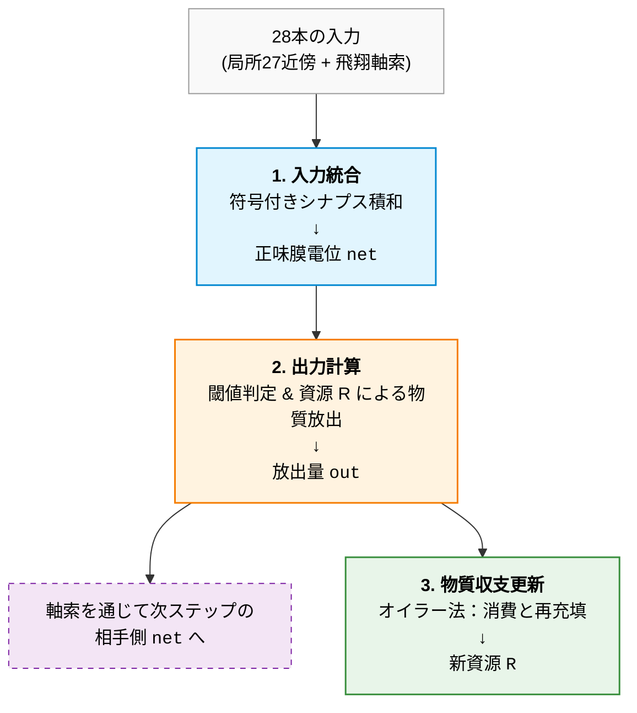
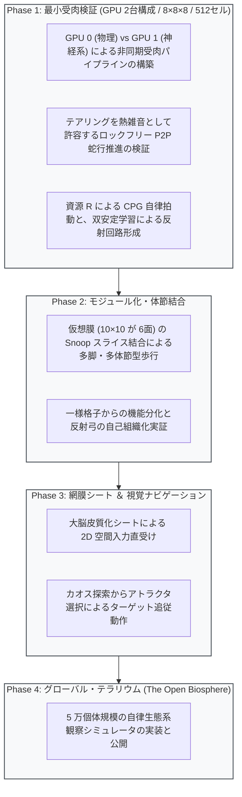

# VoxelBrain (Rev. 4.5)
> **〜 3D 格子における非同期受肉型自律神経力学系 〜**

---

## 1. 設計思想と基本コンセプト

* **力学系による自律的知能:**  
  大域的な最適化器や全結合アテンションを用いず、3D 空間内の局所相互作用に基づく「結合写像格子（Coupled Map Lattice）」を構成し、時空カオス知能を創発させる。
* **局所性と一様格子（Homogeneous Grid）モデル:**  
  セルごとの静的な役割分担を事前定義せず、全 512 セル・全シナプスが同一の物理更新則に従う。空間トポロジーと近傍相互作用の連鎖によって、反射、歩行 CPG、本能的回路などの機能を自律的に創発させる。
* **生物学的スケール:**  
  1 脳の基本単位を線虫（*Caenorhabditis elegans*）の全神経細胞数（302 個）を内包するスケール（512 セル）に設定。
* **非同期受肉（Asynchronous Embodiment）:**  
  * **GPU 0（物理環境）:** 剛体力学、流体、慣性、接触センサ等の高周波物理演算。
  * **GPU 1（知能核）:** VoxelBrain 群（100Hz 神経力学系クロック）。
  * **テアリングの受容:** 排他ロックやダブルバッファリングを用いず、非同期 L2 メモリ競合によるテアリングを物理的熱雑音として許容する。これにより、確率的共鳴（Stochastic Resonance）を介したアトラクタ探索を最小限のオーバーヘッドで実現する。

---

## 2. コア・ニューロダイナミクス（The Compute Core）

GPU アーキテクチャと局所神経力学系のマッピング設計。

### 空間スケールとハードウェア・マッピング
* **計算コアスケール:** `8 × 8 × 8 = 512` セル（1 脳 = `[numthreads(8, 8, 8)]` = 16 Warps）。
  * 512 セル全体が均質な計算コアを構成。
* **レジスタ配置戦略（Occupancy 66.7%）:**  
  SM あたりの常駐数を 2 ブロック（1,024 スレッド / 32 Warps）に設定。
  * 1 スレッドあたり 64 本のレジスタを割り当て、VRAM へのレジスタスピル防止と低レイテンシ実行を維持。

### 生体膜アーキテクチャ（The Membrane Interface）
計算コアの外周を、立方体直交 6 面を覆う仮想膜（ $10 \times 10$ が 6 面）で被覆する。

* **共有メモリデータ構造とバンク衝突の回避:**  
  コア（ $8 \times 8 \times 8$ ）とその外周膜を含む全体を `groupshared half s_membrane[10][10][16]`（約 3.2 KB）として宣言。最内周の $+6$ 要素（ $x = 10 \dots 15$ ）をパディングとし、ストライドを 16 要素に整列させることで共有メモリのバンク衝突を回避する。
* **3 層物理分離メモリモデル:**
  1. **プライベートバッファ（Private VRAM）:** 重み実体（14.3 KB）および内部代謝状態（排他 RW）。
  2. **パブリック Snoop バス（Public VRAM）:** `globallycoherent RWStructuredBuffer` による L2 直撃アクセス。
  3. **生体膜キャッシュ（SM groupshared）:** ステップ開始時にパブリックバスからロードする作業領域。
* **幾何学的スライシングとアライメント:**  
  境界 384 セルを `half2` パッキングで 768 Byte とする。128 Byte キャッシュライン境界（6 本分）に適合させ、偽共有（False Sharing）を低減する。

---

## 3. 神経核ダイナミクス：Tsodyks-Markram 資源統合モデル

不応期・動的閾値・受容体感度調整を、化学物質プール（利用可能小胞） $R \in [0.0, 1.0]$ という 1 つの物理変数に統合する。

### 1. 入力統合（正味の膜電位シフト $\mathrm{net}_i$）
全 28 本のシナプス入力を積和演算し、セル $i$ の正味の膜電位シフト $\mathrm{net}_i$ を算出する。

$$
\mathrm{net}_i = \sum_{j=1}^{28} \mathrm{Sign}_j \cdot \frac{W_{ij}}{255} \cdot \mathrm{out}_j
$$

* **正味入力 $\mathrm{net}_i$:** 興奮性・抑制性のシナプス総和による膜電位シフト（正で脱分極、負で過分極）。
* **$\mathrm{out}_j \in [0.0, 1.0]$:** 送信元セル $j$ の前ステップの出力。外周セルの場合は、外殻仮想膜からフェッチしたセンサ値も含まれる。
* **$W_{ij} \in [0, 255]$:** 8-bit 固定小数点（`uint8`）で保持されるシナプス結合強度。
* **$\mathrm{Sign}_j$:** 送信元セル $j$ の性質に応じた符号（興奮性: $+1.0$ / 抑制性: $-1.0$ ）。
* **結合元（28 本）のトポロジー:**
  * **局所 27 近傍:** 自身を中心とする $3 \times 3 \times 3$ の空間近傍ブロック。
  * **28 番オンザフライ軸索:** ゲノムシードからハッシュ関数で導出する長距離ショートカット。

$$
\mathrm{target\_cell} = \mathrm{WangHash}(\mathrm{thread\_id} \oplus \mathrm{GenomeSeed}) \pmod{512}
$$

> [!NOTE]
> 追加の配線テーブルを VRAM に保持することなく、計算によってオンザフライにスモールワールド構造を形成します。

### 2. 出力計算（物質放出）
正味入力 $\mathrm{net}_i$ から静止閾値を引いた超過分を放出確率 $u$ とし、利用可能資源 $R$ に応じて出力 $\mathrm{out}$ を決定する。

$$
u = \mathrm{saturate}(\mathrm{net}_i - \mathrm{THRESHOLD})
$$

$$
\mathrm{out} = u \times R
$$

### 3. 物質収支更新（消費と再充填）
オイラー法による 1 ステップの物質収支：

$$
R \leftarrow \mathrm{saturate}\left( R - \mathrm{out} + (1.0 - R) \times \mathrm{recover\_rate} \right)
$$

* **動態特性:**
  1. **不応期:** 大量放出（ $u \approx 1.0$ ）直後は $R \approx 0$ となり、次ステップの出力が自然に抑えられる。
  2. **恒常性感度調整:** 高頻度の発火が続くと定常的な $R$ の値が下がり、過剰な興奮を抑制する。
  3. **感度回復:** 休眠状態では $R \approx 1.0$ に向けて充填が進み、小さな刺激にも反応可能となる。
* $R$ は細胞内のプライベート変数として更新され、他セルとの直接共有や同期バリア（`GroupMemoryBarrierWithGroupSync`）を必要としない。

---

## 4. 発生ゲノムと二値双安定シナプス可塑性

### メモリモデル
* **間接符号化ゲノム:**  
  形態形成シード、初期自発発火を誘発する反響結合シード、代謝パラメータ（`recover_rate`, `lambda`, `eta`）を間接符号化する。
* **動的重み実体バッファ（1 脳あたり 14,336 Byte）:**  
  $$512 \text{ セル} \times 28 \text{ 結合} = 14,336 \text{ Byte} \quad (\approx 14.3 \text{ KB})$$

### 確率的丸め（Stochastic Rounding）
整数型シナプス重み（`uint8`）において微小な可塑性更新量（ $\Delta W$ ）が切り捨てられるのを防ぐため、擬似乱数を用いた確率的丸めを適用する。  
カーネル冒頭でスレッド ID とタイムステップに基づいて Wang Hash を適用して初期シードを散布し、シナプス更新ループ内では軽量な乗法合同法（LCG）によって 8-bit 乱数を生成する。更新量の小数部が乱数値を上回った場合にのみ整数重みをインクリメント／デクリメントすることで、アンダーフローを回避しつつ微小な勾配情報を反映させる。

### 二値双安定シナプス結晶化（Bistable Consolidation）
学習率 $\eta$ を式全体に適用し、減衰項にロジスティック形式を採用した三要素学習則。

$$
\Delta W_{ij} = \eta \cdot \left[ \mathrm{Dopamine} \cdot (x_i \cdot x_j) - \lambda \cdot W_{ij} \cdot (255 - W_{ij}) \right]
$$

* **学習率 $\eta$ による一元制御:**  
  $\eta$ は報酬項と減衰項の双方に作用するため、 $\eta = 0$ とすることで忘却を含む全可塑性を停止できる。
* **双安定性とシナプス固定:**  
  中間的な結合強度（ $W \approx 128$ ）は減衰項の影響を強く受けて破棄されやすい一方、強い報酬と同期発火によって $W \to 255$ に達した結合は減衰項が $0$ に収束し、長期的に維持されやすくなる。
* **反射経路の自己組織化:**  
  環境刺激によって外郭セル周辺の結合が強化・固定されることで、特定の反射経路が自律的に形成される。
* **計算特性:**  
  整数演算（乗算・ビットシフト）を中心に構成し、分岐処理（branch divergence）を抑えて高速実行する。

---

## 5. 制御特性と身体性

* **時空カオスとアトラクタ選択（Attractor Selection）:**  
  外部刺激のない状態では、資源 $R$ の変動とショートカット結合の反響により格子全体が高次元カオス（自律探索）を示す。外部入力が加わると、対応する安定な周期軌道（歩行 CPG 等）へ引き込まれる。
* **過剰興奮の抑制:**  
  シナプス結合が全体として高強度に達した場合でも、連続放出によって $R \to 0$ となるため、全セルが持続的に最大発火状態に張り付く現象が抑えられ、振動ダイナミクスへと自律的に移行する。
* **事後学習トグル（ISO 3691-4 準拠）:**  
  運用時は学習を停止（ $\eta = 0$ ）することで、決定論的な非線形コントローラとして動作させることが可能。

---

## 6. ハードウェア規模試算（RTX 3060 12GB / 100Hz 動作）

> [!TIP]
> 実効メモリ帯域 250 GB/s（帯域効率 60〜70% 想定）に基づく試算値。

| 動作モード | 1 脳トラフィック | リアルタイム並列数（100Hz） | ニューロン総数 | 生物学的等価スケール |
| :--- | :--- | :--- | :--- | :--- |
| **学習 ON** （双安定ヘッブ動作） | 約 28 KB | **約 55,000 個の脳** | **約 2,800 万** | **ゼブラフィッシュ全脳規模** |
| **学習 OFF** （推論・制御運用） | 約 14 KB | **約 110,000 個の脳** | **約 5,600 万** | **マウス全脳肉薄規模** |
| **物理真性並行** （1 ウェーブ実行） | — | **56 個の脳** | **28,672 セル** | ハードウェア完全同時実行 |

---

## 7. 実装・実証ロードマップ

