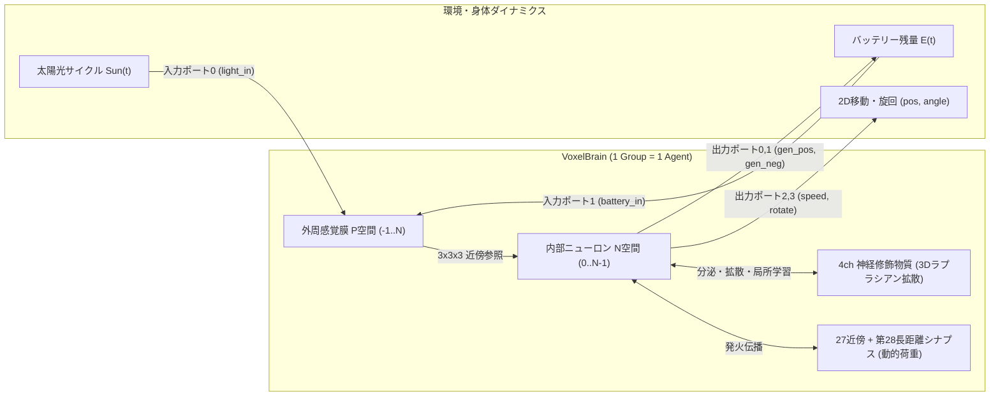
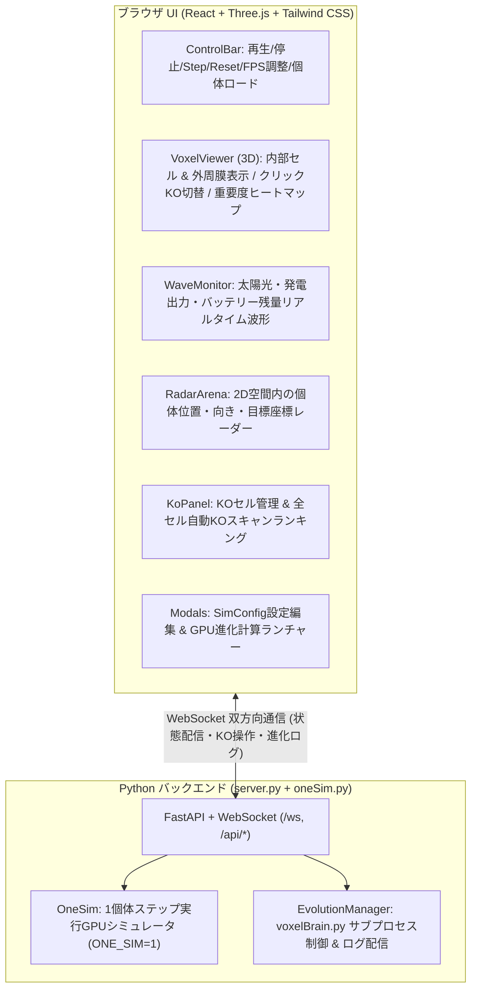

# VoxelBrain: 3D格子結合写像・空間拡散神経修飾・GPU超並列進化システム

**VoxelBrain** は、大域的な誤差逆伝播（Backpropagation）を一切用いず、3次元ボクセル空間内の局所相互作用・化学物質の空間拡散・局所シナプス可塑性・自己適応進化のみから自律的な生存知能を創発させる **GPUネイティブ人工生命 / 神経力学系シミュレータ** です。

Slang コンピュートシェーダー（CUDA / Direct3D 12 / Vulkan 対応の `slangpy` バックエンド）により、数万体規模の3Dニューラルネットワーク群をGPU上で超並列に発生・推論・淘汰・突然変異させます。さらに、進化したエリート個体の内部状態やノックアウト（KO）実験をブラウザ上で直感的に解析できる **VoxelBrain KO Studio**（FastAPI + React + Three.js）を備えています。

---

## 1. 基本設計思想

* **局所相互作用に基づく3D神経力学系（Coupled Map Lattice）**
  各ニューロンは自身の周囲 `3 × 3 × 3`（27近傍）の局所シナプスと、1本の長距離ショートカット結合（第28結合）のみを持ちます。
* **直交シグネチャ内積による初期回路の自己組織化**
  各ボクセルが持つ4次元のシナプス前シグネチャとシナプス後シグネチャの内積から初期シナプス重みを決定し、局所結合と遠隔結合を同一の数理で生成します。
* **非対称生体膜による受肉（Asymmetric Embodiment）**
  内部ニューロン空間（`N × N × N`）と、それを取り囲む外周感覚膜（`(N+2) × (N+2) × (N+2)`）を分離。環境からの感覚入力は外周膜へ注入され、運動・発電出力は内部空間の表面ニューロンから読み出されます。
* **空間拡散する4チャネル神経修飾物質と局所可塑性（Lifelong Learning）**
  ニューロンの発火に応じて分泌される4種類の神経修飾物質（Neuromodulators）が3D空間をラプラシアン拡散し、相互作用行列と重み反応行列を介して各シナプス重みをリアルタイムに動的修飾（生涯学習）します。
* **メタ進化（自己適応変異）と3D構造コピー変異**
  変異率・拡散ステップ数・拡散係数自体を遺伝子として進化させるメタ進化機構に加え、脳内の3D部分領域を別座標へ複製・反転転写する「3Dブロックコピー変異」により、モジュール構造の創発を促します。

---

## 2. システムアーキテクチャと空間構造

### 2.1 ボクセル空間スケール
空間解像度はパラメータ `DIM` によって決定されます（標準: `DIM = 2`）。

| パラメータ | 数式 / 定義 | `DIM = 1` | `DIM = 2` (標準) | `DIM = 3` |
| :--- | :--- | :---: | :---: | :---: |
| **内部グリッド幅 (`N`)** | `1 << DIM` | `2` | `4` | `8` |
| **内部ニューロン総数 (`TOTAL_N`)** | `N * N * N` | `8` | `64` | `512` |
| **外周膜込み幅 (`P`)** | `N + 2` | `4` | `6` | `10` |
| **外周膜込み総セル数 (`TOTAL_NP2`)** | `P * P * P` | `64` | `216` | `1000` |

* **内部ニューロン空間（`N` 空間）**: 各軸 `0 .. N-1`。ニューロンの発火、小胞資源 `R`、シナプス重み（28本/セル）、および神経修飾物質（4チャネル）が存在します。
* **外周感覚膜空間（`P` 空間）**: 各軸 `-1 .. N`（配列インデックス `0 .. P-1`）。外周1セル分の殻が感覚受容膜として機能します。



---

## 3. ゲノム構造と発生プロセス（`generation.slang`）

### 3.1 個体ゲノム構成（Format Ver 2.0）
1個体あたりのゲノムは、以下のデータ構造としてGPUバッファ（SoA: Structure of Arrays）および `.npz` ファイルで管理されます。

```cpp
// 1個体あたりの主要ゲノム構成（論理構造）
struct AgentGenome {
    // 1. 神経基底フィールド
    half4  sig_pre[TOTAL_NP2];       // シナプス前シグネチャ (P空間, 4ch, [-1.0, 1.0])
    half4  sig_post[TOTAL_NP2];      // シナプス後シグネチャ (P空間, 4ch, [-1.0, 1.0])
    half4  neuromod_gen[TOTAL_N];    // 発火時の神経修飾物質分泌マップ (N空間, 4ch)
    uint32 inhib_bits[INHIB_STRIDE]; // 抑制性(-1) / 興奮性(+1) ビットパック配列

    // 2. 神経発火・小胞資源パラメータ (ResourceParams)
    half   base_output;              // 基礎放出率 (0.0005 ~ 0.1)
    half   beta;                     // 膜電位感度ゲイン (15.0 ~ 30.0)
    half   k_refill;                 // 小胞資源の再充填速度 (0.01 ~ 0.5)

    // 3. 第28長距離結合パラメータ (Link28thParams)
    uint32 multiplier;               // アフィン乗数 (奇数)
    uint32 bias;                     // アフィンオフセット

    // 4. 神経修飾物質・可塑性パラメータ (NeuromodParams)
    half4x4 neuromod_rel_matrix;         // 修飾物質間の4x4反応・減衰行列
    half4   neuromod_weight_reaction[4]; // シナプス重み更新用の反応係数ベクトル (4x4)
    half    neuromod_diff;               // 修飾物質の空間拡散係数

    // 5. 入出力ポート座標 (InoutParamsFi: [face(0..5), u, v])
    int3   in_ports_fi[NUM_IN_PORTS];    // 感覚入力ポート (外周膜6面)
    int3   out_ports_fi[NUM_OUT_PORTS];  // 運動出力ポート (内部表面6面)

    // 6. 自己適応メタ変異パラメータ (MutationParams)
    // sig_mut, neuromod_map_mut, neuromod_params_mut, iicu_mut, rlmu_mut
};
```

### 3.2 GPU手続き型発生（Genesis）
初期世代（Step 0）の個体群生成は `generation.slang` によってGPU上で高速に実行されます。
1. **3D Perlinノイズによる連続場生成**:
   `sig_pre`、`sig_post`、`neuromod_gen` の各4チャネルは、個体ごとに異なる周波数（`freqs`）・シード（`seeds`）・カットオフ（`cutoffs`）・バイアス（`biases`）を持つ3D Perlinノイズから生成され、滑らかな空間勾配を持つ初期脳構造を形成します。
2. **側抑制セルオートマトンによる興奮/抑制マップ生成**:
   初期乱数場に対して近傍最大値との差分を増幅する反復フィルタを適用し、閾値判定と Warp Ballot 命令（`WaveActiveBallot`）によって興奮性・抑制性ニューロンの空間分布ビットマップを生成します。

---

## 4. 神経・環境ダイナミクス（`reasoningSim.slang`）

1世代あたり `INNER_STEPS`（標準: 30ステップ、KO Studio実行時は最大1000ステップ等）のループを回し、各ステップで以下の計算を行います。

### 4.1 シナプス初期重みの決定
世代開始時（`is_init == 1`）、ニューロン `i` と接続先セル `j`（近傍27セルおよび第28長距離セル）の初期シナプス重み `W_ij`（範囲 `[0.0, 1.0]`）をシグネチャ内積で初期化します。

```text
W_ij = saturate( 0.25 * dot(sig_post[i], sig_pre[j]) )
```

第28長距離結合の接続先インデックスは以下の通り決定論的に算出されます。

```text
coord_28th = indexToCoordN( (groupIndex * multiplier + bias) % TOTAL_N )
```

### 4.2 4チャネル神経修飾物質の拡散・生成・反応
各内部ニューロンは4チャネルの神経修飾物質濃度ベクトル `m_i`（`half4`）を保持します。毎ステップ以下の順で更新されます。

1. **3Dラプラシアン拡散**:
   27近傍の濃度合計と自身の濃度から離散ラプラシアンを計算し、拡散係数 `diff` で空間拡散させます（`dt = 1.0 / 54.0`）。
   ```text
   laplacian = sum_{27近傍}(m_neighbor) - 27.0 * m_i
   m_i <- m_i + (diff * laplacian) * (1.0 / 54.0)
   ```
2. **活動依存分泌と4×4相互作用行列**:
   直前のニューロン出力 `my_output` に応じて修飾物質が分泌され、`4 × 4` 行列 `neuromod_rel_matrix` によってチャネル間の促進・抑制・減衰が計算されます。
   ```text
   m_i <- m_i + my_output * neuromod_gen_map[i]
   m_i <- max(0.0, neuromod_rel_matrix * m_i)
   ```

### 4.3 局所シナプス可塑性（生涯学習）と入力集計
近傍27シナプスの重み `my_weight` は、自身の修飾物質濃度 `cur_nm` とシナプス前セルの修飾物質濃度 `neighbor_neuromod` に応じて毎ステップ動的に更新されます。

```text
// 1. 入力の集計 (27近傍 + 第28長距離結合)
delta_net = output[j] * my_weight
net += delta_net

// 2. 修飾物質によるシナプス重みのリアルタイム更新 (27近傍)
new_weight = 0.0
for k = 0 .. 3:
    new_weight += dot(
        half4(cur_nm[k], neighbor_neuromod[k], my_weight, 1.0),
        neuromod_weight_reaction[k]
    )
my_weight = saturate(new_weight)
```

この定式化により、ヘッブ型強調・減衰・自己維持（`weight_reaction[k].z`）・定数ドリフトがすべて4次元内積のみで分岐なく表現されます。

### 4.4 ニューロン発火と小胞資源（Vesicle Resource）モデル
集計された入力電位 `net` から、GPUネイティブの `exp2` 命令を用いた反応速度式で放出率 `output_rate` を算出し、利用可能なシナプス小胞資源 `R`（範囲 `[0.0, 1.0]`）との積によって出力を決定します。

```text
scaled_net  = clamp(net * beta, -20.0, 20.0)
output_rate = min(1.0, base_output * exp2(scaled_net))
my_output   = my_inhib * output_rate * R   // my_inhib は +1 (興奮性) または -1 (抑制性)

// 小胞資源の消費と再充填
R = saturate(R - output_rate * R + k_refill)
```

※ `ONE_SIM`（KO実験モード）有効時は、`ko_mask_all` で指定されたノックアウト対象セルの `my_output` が強制的に `0.0` に固定されます。

### 4.5 身体運動・太陽光サイクルとエネルギー収支
固定長スロット方式（`sim_config.py`）により、感覚入力と運動出力が外周膜・内部表面の6面に割り当てられます。

* **感覚入力ポート（`NUM_IN_PORTS = 2`、外周膜6面）**
  * スロット `0` (`light_in`): 現在の太陽光強度 `current_sunlight`
  * スロット `1` (`battery_in`): 現在の個体エネルギー残量 `my_energy_s`
* **運動出力ポート（`NUM_OUT_PORTS = 4`、内部表面6面）**
  * スロット `0` (`gen_pos_out`): 発電機・正極出力
  * スロット `1` (`gen_neg_out`): 発電機・負極出力
  * スロット `2` (`speed_out`): 前進・後退アクチュエータ出力
  * スロット `3` (`rotate_out`): 旋回アクチュエータ出力

毎ステップ、スレッド0が個体の2D座標・向き・エネルギー収支を更新します：

```text
// 1. 太陽光強度 (半周期 SUN_CYCLE_PERIOD の正弦波半波整流)
current_sunlight = saturate( sin(pi * inner_step / SUN_CYCLE_PERIOD) )

// 2. 発電出力
generator_power = saturate( output[out_port_0] - output[out_port_1] )

// 3. 2Dアリーナ内の移動 (座標範囲 [-2.0, 2.0])
my_angle += output[out_port_3] * ROTATE_GAIN
my_speed  = output[out_port_2] * SPEED_GAIN
my_pos   += float2(cos(my_angle), sin(my_angle)) * my_speed
my_pos    = clamp(my_pos, -2.0, 2.0)

// 4. エネルギー収支更新 (E <= 0 で餓死・活動停止)
my_energy -= METABOLIC_COST
my_energy -= abs(generator_power) * GEN_COST_RATE
my_energy += SOLAR_GAIN_RATE * abs(generator_power) * current_sunlight
my_energy  = saturate(my_energy)
```

---

## 5. 超並列進化と自己適応変異エンジン（`mutation.slang` & `elite_manager.py`）

### 5.1 生存判定とリング親探索
推論フェーズ終了時の最終エネルギー残量 `my_energy_s` がそのまま次世代への生存確率（`mutation_rate_all`）となります。
* 生存判定に通過した個体は無傷で次世代へ維持されます。
* 脱落した個体は、グループ内の全スレッドでリング状に他個体を並列走査し、`InterlockedMin` によって最初に見つかった生存個体を「親（`base_id_s`）」として選び、その遺伝子をコピー＆突然変異させて新たな子個体となります。

### 5.2 3つの高度な突然変異メカニズム
1. **メタ進化（Self-Adaptive Mutation）**:
   各遺伝子群の変異確率（`rate`）・変異幅（`max`）・空間拡散ステップ数（`steps`）・拡散係数（`diff`）自体が個体ごとの遺伝子として保持されており、親から子へ受け継がれる際にメタ変異パラメータ（`MutateMutationParams`）によって自己適応的に進化します。
2. **ラプラシアン拡散ノイズ変異**:
   `sig_pre`、`sig_post`、`neuromod_map` に対する変異ノイズは、単なる独立乱数ではなく、初期スパース乱数を3Dラプラシアン拡散で数ステップ平滑化してから親遺伝子へ加算されます。これにより、空間的なまとまりを持った機能領野が壊れずに進化します。
3. **3Dブロックコピー変異（`CopyMutation`）**:
   確率 `copy_mutation_params.rate` で発動し、`sig_pre` / `sig_post` 空間内のランダムな直方体領域（`start_base`, `size`）を別の座標（`end_base`）へブレンド転写します。その際、X/Y/Z軸のランダムな鏡像反転（`reverse_xyz`）を伴うため、生体脳における遺伝子重複や左右対称・反復モジュール構造の獲得を模倣します。

### 5.3 エリート保存・均等Modulo分配（`EliteManager`）
* 進化実行中、最高スコア更新時・定期インターバル・終了時に上位20体が `backups/checkpoint_YYYYMMDD_HHMMSS/top20/` に自己記述型 `.npz`（Format Ver 2.0）として自動保存されます。
* 1位の個体は常に `backups/latest_best.npz` へ自動同期されます。
* 保存されたエリート群から進化を再開する際（`VB_LOAD_ELITES=1`）は、特定個体への過度な集中を防ぐため、フォルダ内の全エリート個体を母集団全体へ **均等Modulo分配（`agent_id % num_elites`）** して多様性を維持します。

---

## 6. VoxelBrain KO Studio（Web GUI & `oneSim.py`）

進化したエリート個体の3D脳活動・シナプス動態・ノックアウト（KO）影響をブラウザ上でリアルタイムに可視化・実験できる統合スタジオです。



### 主な機能
* **インタラクティブ 3D ボクセルビューア**:
  Three.js により内部ニューロン（`N × N × N`）の発火状態、外周感覚膜（`P × P × P`）、および入出力ポート（☀️ 太陽光入力、⚡ バッテリー入力、⚙️ 発電正負極、🚀 速度・旋回出力）を3D表示。任意のセルを直接クリックして即座に **ノックアウト（出力0固定）** を切り替えられます。
* **全セル自動 KO スキャン（重要度ランキング）**:
  全内部ニューロンを1セルずつ順番にノックアウトして1000ステップの高速評価を行い、ベースラインからの最終エネルギー低下量（Drop量）を自動計測。どのニューロンが生存・発電に不可欠な「中枢ニューロン」であるかを3Dヒートマップとランキング表で特定できます。
* **リアルタイム波形モニター ＆ 2Dレーダー**:
  太陽光サイクルに対する発電タイミングの同期具合やバッテリー残量の推移、2Dアリーナ上の移動軌跡をリアルタイムに観察できます。
* **ブラウザ完結の設定編集 ＆ GPU進化ランチャー**:
  GUI上から [`sim_config.py`](sim_config.py) の代謝コストやポート設定を書き換えて即座に再コンパイルしたり、バックグラウンドで [`voxelBrain.py`](voxelBrain.py) の進化計算を起動・安全停止・リアルタイムログ監視することができます。

---

## 7. ディレクトリ・ファイル構成

| ファイル / ディレクトリ | 役割 |
| :--- | :--- |
| [`sim_config.py`](sim_config.py) | 入出力ポート数、初期エネルギー、代謝コスト、発電ゲイン、移動・旋回ゲイン等の共通設定 |
| [`generation.slang`](generation.slang) | 初期世代の3D Perlinノイズ発生＆側抑制による興奮/抑制マップ生成コンピュートシェーダー |
| [`reasoningSim.slang`](reasoningSim.slang) | 神経力学系・4ch神経修飾物質拡散・局所可塑性・太陽光タスク評価コンピュートシェーダー |
| [`mutation.slang`](mutation.slang) | 生存親探索・メタ進化・ラプラシアン拡散変異・3Dブロックコピー変異コンピュートシェーダー |
| [`voxelBrain.py`](voxelBrain.py) | GPU超並列進化計算メインエンジン（モノリシック実行モード ＆ VRAM同期分割モード対応） |
| [`elite_manager.py`](elite_manager.py) | エリート個体の `.npz`（Ver 2.0）保存・読み込み・均等Modulo分配マネージャー |
| [`oneSim.py`](oneSim.py) | 1個体専用の毎ステップ状態同期・KO実験・全セル重要度スキャン用GPUシミュレータ |
| [`server.py`](server.py) | FastAPI + WebSocket による VoxelBrain KO Studio バックエンドサーバー |
| [`web/`](web/) | React + TypeScript + Three.js + Vite によるフロントエンドWebアプリケーション |
| `backups/` | 進化計算で保存されたエリート個体（`.npz`）および `latest_best.npz` の格納ディレクトリ |
| `logs/` | 世代ごとのエネルギー統計（平均・最大・黒字個体数など）のCSVログ出力先 |

---

## 8. セットアップと使い方

### 8.1 必要環境
* **OS**: Windows / Linux
* **Python**: 3.13 以上（[`uv`](https://docs.astral.sh/uv/) または `.venv` 推奨）
* **GPU**: CUDA または Direct3D 12 / Vulkan 対応 GPU（`slangpy` が動作すること）
* **Node.js**: フロントエンド（`web/`）をビルド・開発する場合のみ必要

### 8.2 インストール

```powershell
# Python 仮想環境の同期 (uv を使用する場合)
uv sync

# フロントエンドの依存関係インストールとビルド (初回またはUI変更時)
cd web
npm install
npm run build
cd ..
```

### 8.3 VoxelBrain KO Studio（Web GUI）の起動
以下のコマンドを実行すると、FastAPI サーバーが起動し、自動的にブラウザで `http://localhost:8000` が開きます。

```powershell
.venv\Scripts\python.exe server.py
```

> **開発モードでフロントエンドを起動する場合**:
> `server.py` を起動した状態で、別ターミナルにて `cd web && npm run dev` を実行すると `http://localhost:3000` でホットリロード付きで操作できます。

### 8.4 GPU 進化計算の CLI 直接実行（`voxelBrain.py`）
コマンドラインから直接、数万体規模の並列進化計算を実行できます。実行中に `Ctrl+C` を1回押すと、現在のステップ完了後に上位20体を安全に保存して終了します。

```powershell
# デフォルト設定で進化計算を実行 (個体数 32768, DIM=2, 50000世代)
.venv\Scripts\python.exe voxelBrain.py

# オプション指定例: 世代数 10000, 1世代あたり 60 inner_steps, 10世代ごとにGPU同期ログ出力
.venv\Scripts\python.exe voxelBrain.py --steps 10000 --inner-steps 60 --wait-interval 10

# 保存済みエリート個体群 (backups/elites 等) を読み込んで進化を再開する場合
$env:VB_LOAD_ELITES="1"
$env:VB_LOAD_FOLDER="backups/elites"
.venv\Scripts\python.exe voxelBrain.py
```

#### 主な CLI 引数・環境変数
| CLI 引数 | 環境変数 | デフォルト値 | 説明 |
| :--- | :--- | :---: | :--- |
| `--steps`, `-n` | `VB_TOTAL_STEPS` | `50000` | 総世代数（進化ステップ数） |
| `--inner-steps` | `VB_INNER_STEPS` | `30` | 1世代あたりの推論ステップ数 |
| `--sub-inner-steps` | `VB_SUB_INNER_STEPS` | `inner_steps` と同値 | VRAM書き戻し間隔（`inner_steps` 未満にすると分割同期モードが有効化） |
| `--dim` | `VB_DIM` | `2` | ボクセル解像度次元（`1`: `2×2×2`, `2`: `4×4×4`, `3`: `8×8×8`） |
| `--m` | `VB_M` | `32768` | 同時シミュレーション個体群サイズ |
| `--wait-interval` | `VB_WAIT_INTERVAL` | `1` | GPU同期およびコンソールログ出力間隔（ステップ数） |
| `--stop-file` | `VB_STOP_FILE` | `""` | 指定パスのファイルが生成されたら安全に保存して終了 |
| - | `VB_LOAD_ELITES` | `"0"` | `"1"` に設定すると開始時にエリート個体をロードして母集団に均等分配 |
| - | `VB_LOAD_FOLDER` | `"backups/elites"` | エリート個体の読み込み元フォルダパス |

### 8.5 単一個体シミュレータの CLI / Python API 利用（`oneSim.py`）
特定の `.npz` 個体を指定して、1000ステップの推論テストやPythonスクリプトからの詳細解析を行えます。

```powershell
# 最新のベスト個体をロードして1000ステップ実行
.venv\Scripts\python.exe oneSim.py backups/latest_best.npz
```

Python スクリプトから `OneSim` クラスを直接制御する例：

```python
from oneSim import OneSim

# エリート個体をロードしてシミュレータを初期化
sim = OneSim(dim=2, agent_data="backups/latest_best.npz")

# 特定のニューロン (x=1, y=2, z=0) をノックアウト
sim.set_ko(1, 2, 0, True)

# 1ステップずつ実行して内部状態を取得
for step in range(100):
    state = sim.step()
    print(f"Step {state['inner_step']}: Energy={state['energy']:.4f}, Pos={state['pos']}")

# 全64セルの自動ノックアウト重要度スキャンを実行
scan_res = sim.scan_ko_all(total_inner_steps=1000)
print("最も重要なニューロン Top 3:", scan_res["rankings"][:3])
```

---

## 9. ライセンス (License)

本プロジェクトは **Apache License 2.0** のもとで公開されています。詳細はリポジトリルートの `LICENSE` ファイルを参照してください。

