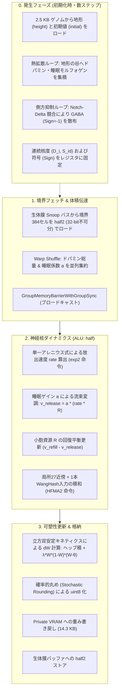

# VoxelBrain (Rev. 5.2) 技術仕様書
## 3D格子における非平衡散逸型・モルフォゲン発生自律神経力学系

---

### 1. 基本設計思想

* **力学系による自律的知能**:  
  大域的な最適化器や全結合アテンションを用いず、3D空間内の局所相互作用に基づく結合写像格子（Coupled Map Lattice）を構成し、時空カオスおよび散逸構造を創発させる。
* **物理発生学に基づく細胞分化（Morphogenetic Development）**:  
  パーリンノイズやブルーノイズなどの人工的な外部テクスチャを完全に排除する。全512セルに対等に割り当てられた遺伝的地形と物理拡散方程式（熱伝導および側方抑制）の相互作用のみから、ドパミン核、睡眠中枢、GABA抑制網を自律析出させる。
* **均質格子（Homogeneous Grid）の維持**:  
  セルごとの静的な役割分担（If文による二値的分岐）を排除する。全セルが同一の更新則を保持し、発生フェーズで獲得した連続的な分化度（核度）および生体膜を介した外部環境との境界条件により、自律神経機能を連続的に発現させる。
* **非同期受肉（Asynchronous Embodiment）**:  
  物理環境（GPU 0）と神経力学系核（GPU 1）を分離し、排他ロックを用いないL2メモリ競合による時間軸テアリングを許容する。これにより確率的共鳴を最小のオーバーヘッドで獲得する。

---

### 2. ゲノム構造および発生フェーズ（Developmental Epoch）

外部ノイズ生成器を排し、1個体あたり **2.5 KB (2,560 Byte)** の極小ゲノムを基点として、初期化時に数ステップの物理シミュレーションを実行する。

#### 2.1 ゲノム・メモリマッピング（Structure of Arrays: SoA）
GPUメモリトランザクション（128 Byte境界）に最適化した5本のフラットバッファで構成する。20,000体の大規模並列進化時でも総容量は約 51.2 MB に収まり、GPU VRAM上に常駐可能とする。

```cpp
// 1個体あたりのゲノム構造体 (Total: 2,560 Bytes = 2.5 KB)
struct Genome {
    uint8_t da_height[512];     // ドパミン地形ポテンシャル (512 Byte)
    uint8_t da_initial[512];    // ドパミン初期モルフォゲン (512 Byte)
    uint8_t sleep_height[512];  // 睡眠中枢地形ポテンシャル (512 Byte)
    uint8_t sleep_initial[512]; // 睡眠中枢初期モルフォゲン (512 Byte)
    uint8_t gaba_initial[512];  // GABA初期シード (512 Byte)
};
```

#### 2.2 ドパミン核および睡眠中枢の発生（ポテンシャル流束・熱拡散）
熱伝導方程式のラプラシアン平滑化作用（天然の低周波ローパスフィルター）を利用し、初期のガタつきを丸めながら地形の「谷（くぼみ）」へモルフォゲンを自律凝集させる。

1. **ドリフト・熱拡散方程式（有限差分）**:
   各セル $i$ のモルフォゲン濃度 $M_i$ を、局所27近傍 $j$ とのポテンシャル差（高さ $H$）に基づいて更新する。

$$M_i^{(t+1)} = M_i^{(t)} + D \sum_{j \in 27\text{近傍}} w_{ij} \left( (M_j^{(t)} - H_j) - (M_i^{(t)} - H_i) \right) - \gamma M_i^{(t)}$$

   * $w_{ij}$ : 幾何学的距離に応じた等方化重み（面: $1.0$、辺: $1/\sqrt{2}$、角: $1/\sqrt{3}$）。
   * $\gamma$ : 散逸・クリアランス係数。

3. **連続核度への焼き込み（Branchless Mapping）**:
   数ステップの拡散後、到達濃度 $M_i$ から各セルの「ドパミン核度 $D_i \in [0.0, 1.0]$」および「睡眠中枢度 $S^{\mathrm{id}}_i \in [0.0, 1.0]$」をシグモイド／活性化関数で連続値として算出し、レジスタに固定する。二値的分岐（If文）を排し、境界が滑らかに減衰する生体組織構造を形成する。

#### 2.3 GABA抑制網の発生（Notch-Delta型 側方抑制）
ブルーノイズマスクを使わず、細胞同士の局所競合（側方抑制）により、ポアソンディスク状に均一分散した抑制性セル群を自己組織化させる。

1. **局所競合方程式**:
   初期シード $u_i = \mathrm{gaba\_initial}_i / 255.0$ に対し、近傍27セルの合計値による引き算を数反復実行する。

   $$u_i^{(t+1)} = \mathrm{saturate}\left( u_i^{(t)} - \kappa \sum_{j \in 27\text{近傍}} u_j^{(t)} \right)$$

2. **符号（Sign）の確定**:
   競合に打ち勝ったセル（局所極大点）を $\mathrm{Sign}_i = -1.0$（抑制性 / GABA）、それ以外のセルを $\mathrm{Sign}_i = +1.0$（興奮性 / グルタミン酸）として確定する。

---

### 3. 計算コアおよびメモリマッピング

#### 空間スケールとスレッド割り当て
* 計算単位: 8 × 8 × 8 = 512セル（1 Thread Group = 16 Warps）。
* ハードウェア常駐性: SMあたり2ブロック（1,024スレッド / 32 Warps）。1スレッドあたり64レジスタを配分し、レジスタスピルを防止。

#### 二層データモデル（Two-Tier Architecture）
* 内部演算領域（Compute）:
  * スレッドレジスタおよび共有メモリ内は半精度浮動小数点（`half`）を採用。
  * Ampereアーキテクチャの倍速FP16積和演算器（HFMA2）および特殊関数ユニット（SFU）を活用し、連続値キネティクスを実行する。
* 外部記憶領域（Storage）:
  * シナプス重み実体は8-bit符号なし整数（`uint8`）としてPrivate VRAMに格納（512セル × 28結合 = 14,336 Byte / 約 14.3 KB）。
  * 浮動小数点で計算された更新量（$dW$）は、確率的丸め（Stochastic Rounding）を介して `uint8` へ量子化し、微小勾配のアンダーフローを防止する。

#### 生体膜インターフェース
* 幾何構造:
  コア外周の直交6面を覆う仮想膜（10 × 10 が6面）。
  共有メモリデータ構造として `groupshared half s_membrane[10][10][16]`（約 3.2 KB）を確保。最内周の+6要素をパディングとし、ストライド16によりバンク衝突を回避する。
* ハードウェア不可分境界:
  境界384セルは隣接する2セルを一括した `half2`（32-bit = 4 Byte）単位でパッキングし、全体で 768 Byte とする。
  バッファ先頭を4バイトアライメント（`alignas(4)`）に整列させ、GPUの32-bit単一ロード/ストア命令を保証する。

---

### 4. 神経核ダイナミクス：単一アレニウス速度論および睡眠変調

不応期、感度調整、誘発放出、および自発放出（mEPSC）を単一の反応速度論に統合し、睡眠中枢による動的ゲイン変調を適用する。

#### 1. 睡眠活動ゲイン（Sleep Factor）の算出
全睡眠中枢ニューロン群（$n$ 個）の出力和 $S$ に基づき、脳全体の活動倍率 $a \in [0.0, 1.0]$ を決定する。

$$ a = 1.0 - \frac{S}{n} $$

* 覚醒時（ $S \approx 0$ ）: $a \approx 1.0$ となり、通常の高速応答を維持する。
* 睡眠時（ $S > 0$ ）: $a \to 0$ となり、シナプス伝達のボリュームが一斉に鎮静化する。

#### 2. 放出反応速度（単一のアレニウス式）
膜電位入力（ $\mathrm{net}$ ）に応じてエネルギー障壁が線形に変調される単一の速度式を採用する。

$$ \mathrm{rate}_i = k_0 \cdot \exp_2\left( \mathrm{net}_i \cdot \beta \right) $$

* 計算特性: 特殊関数ユニットの `exp2` 命令により分岐なしで算出する。

#### 3. 小胞資源（R）の熱力学的平衡と睡眠変調流束
利用可能資源 $R \in [0.0, 1.0]$ の時間発展は、消費流束と充填流束の差分方程式に従う。放出流束 $v_{\mathrm{release}}$ に睡眠倍率 $a$ を直接乗算する。

$$ v_{\mathrm{release}, i} = a \cdot \left( \mathrm{rate}_i \cdot R_i \right) $$

$$ v_{\mathrm{refill}, i} = k_{\mathrm{rec}} \cdot (1.0 - R_i) $$

$$ R_i \leftarrow \mathrm{saturate}\left( R_i + (v_{\mathrm{refill}, i} - v_{\mathrm{release}, i}) \cdot \Delta t \right) $$

睡眠時（ $a \to 0$ ）は放出消費が停止し、小胞資源 $R$ が熱力学的上限（1.0）へ向けて急速に再充填（代謝回復）される。

#### 4. 入力統合（質量作用の法則）
全28本の入力（局所27近傍 + WangHashによる長距離ショートカット1本）を積和演算する。

$$ \mathrm{net}_i = \sum_{j=1}^{28} \mathrm{Sign}_j \cdot W_{ij} \cdot v_{\mathrm{release}, j} $$

* $W_{ij} \in [0.0, 1.0]$ : シナプス後膜に配置された有効受容体数（`uint8` の値を $1/255.0$ 倍して展開）。
* $\mathrm{Sign}_j$ : 発生フェーズで確定した固有符号（$+1.0$ または $-1.0$）。

---

### 5. 内生体積伝達：ドパミンおよび睡眠抑制の並列集約

排他ロックを用いず、Warp Shuffleによる並列リダクションによって、ドパミン総量と睡眠中枢出力和を一括集約する。

#### 並列リダクション・パイプライン
1. 各スレッドが自己のドパミン分泌量（ $D_i \cdot v_{\mathrm{release}, i}$ ）および睡眠中枢出力（ $`S^{\mathrm{id}}_i \cdot v_{\mathrm{release}, i}`$ ）をレジスタに保持。
2. Warp内32スレッド間で `WaveActiveSum` を実行し、両変数の小計を算出（所要時間: 5クロック）。
3. 各Warpの代表スレッド（Lane 0）が共有メモリ配列 `s_warp_pool[16]` に小計を格納。
4. `GroupMemoryBarrierWithGroupSync()` によりグループ内同期。
5. Warp 0 の代表スレッド群が16要素を再度 `WaveActiveSum` で合算し、大域変数 `s_global_dopamine` および `s_global_sleep_factor`（ $= a$ ）を算出。
6. `GroupMemoryBarrierWithGroupSync()` により、全512スレッドへブロードキャスト。

アトミック命令を完全に排除し、 $O(\log N)$ の一定レイテンシで体積伝達を完了させる。

---

### 6. シナプス可塑性：立方双安定受容体ダイナミクスと睡眠選別（SHY仮説）

受容体クラスタリングの物理モデルに基づき、**立方双安定（Cubic Bistable）キネティクス**を採用する。睡眠時の活動鎮静下において、重要な記憶の自己結晶化とノイズ結合の選択的剪定を同時に成立させる。

#### 1. 学習方程式
```math
\Delta W_{ij} = \eta \cdot \left[ s\text{\_}global\text{\_}dopamine \cdot (x_i \cdot x_j) + \lambda \cdot W_{ij} (1.0 - W_{ij})(W_{ij} - \theta) \right]
```

* $x_i, x_j$ : シナプス後セルおよび前セルの活動量（流束 $v_{\mathrm{release}}$ ）。
* $\lambda$ : 双安定受容体トラフィッキング速度係数。
* $\theta \in (0.0, 1.0)$ : 記憶維持と剪定の境界閾値（標準値: $\theta = 0.5$ ）。

#### 2. 双安定相空間ダイナミクス（Bistable Phase Dynamics）
第2項 $f(W) = \lambda W(1 - W)(W - \theta)$ は、 $[0.0, 1.0]$ 区間において2つの安定固定点と1つの不安定固定点を形成する。

* **$W = 0.0$（安定固定点）**: シナプス完全消退（非結合状態）。
* **$W = 1.0$（安定固定点）**: シナプス後肥厚部（PSD）の足場タンパク質が飽和した強固な記憶状態。
* **$W = \theta$（不安定固定点）**: 生死を分けるポテンシャルの尾根。

#### 3. 覚醒時と睡眠時の自律選別（SHY仮説の実装）
* **覚醒時ダイナミクス（情報刻印）**:
  活動流束 $x_i, x_j$ が激しく励起され、報酬（ドパミン）存在下でヘッブ積項 $`s\text{\_}global\text{\_}dopamine \cdot (x_i \cdot x_j)`$ が双安定項を圧倒する。結合強度は急速にポテンシャルの尾根 $\theta$ を越えて増大する。
* **睡眠時ダイナミクス（記憶の選別と結晶化）**:
  睡眠ゲイン $a \to 0$ により活動量 $x \to 0$ となり、ヘッブ項が静態化する。この間、双安定項のみが支配的となる。
  * **強固な結合（ $W_{ij} > \theta$ ）**:
    $(W_{ij} - \theta) > 0$ となり変化量は **正（＋）** へ転じる。睡眠中に自律的に **$W \to 1.0$ へ引き寄せられ、記憶が結晶化（Consolidation）** される。
  * **中途半端なノイズ結合（ $W_{ij} < \theta$ ）**:
    $(W_{ij} - \theta) < 0$ となり変化量は **負（−）** へ転じる。睡眠中に最大速度で **$W \to 0.0$ へ削ぎ落とされ、完全に剪定（Pruning）** される。

#### 4. 数値安定性とGPU親和性
* **自己閉性（Self-Bounding）**:
  境界 $W=0.0$ および $W=1.0$ において因子 $W(1-W) = 0$ となるため、値域外への発散（オーバーフロー）が原理的に発生せず、不連続なクランプ命令（`saturate`）に依存しない。
* **計算コスト**:
  HFMA2命令による乗算がわずか1回増加するのみで、分岐（If文）を一切伴わずに完全な双安定相転移を実行する。

---

### 7. 実行パイプラインのフロー


