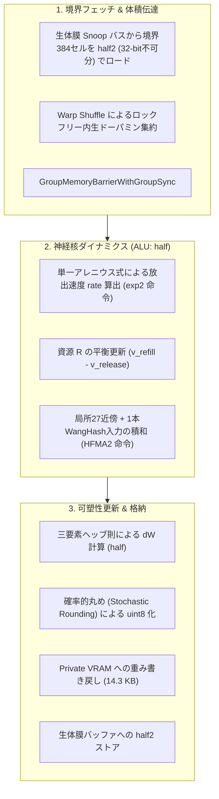

# VoxelBrain (Rev. 5.0) 技術仕様書
## 3D格子における非平衡散逸型・非同期受肉自律神経力学系

---

### 1. 基本設計思想

* 力学系による自律的知能:  
  大域的な最適化器や全結合アテンションを用いず、3D空間内の局所相互作用に基づく結合写像格子（Coupled Map Lattice）を構成し、時空カオスおよび散逸構造を創発させる。
* 均質格子（Homogeneous Grid）モデル:  
  セルごとの静的な役割分担を事前定義せず、全512セルおよび全シナプスが同一の更新則に従う。空間トポロジー、近傍相互作用、および生体膜を介した外部環境との境界条件により、CPGや反射回路等の機能を自律分化させる。
* 非同期受肉（Asynchronous Embodiment）:  
  物理環境（GPU 0）と神経力学系核（GPU 1）を分離し、排他ロックを用いないL2メモリ競合による時間軸テアリングを許容する。これにより確率的共鳴を最小のオーバーヘッドで獲得する。

---

### 2. 計算コアおよびメモリマッピング

#### 空間スケールとスレッド割り当て
* 計算単位: 8 × 8 × 8 = 512セル（1 Thread Group = 16 Warps）。
* ハードウェア常駐性: SMあたり2ブロック（1,024スレッド / 32 Warps）。1スレッドあたり64レジスタを配分し、レジスタスピルを防止。

#### 二層データモデル（Two-Tier Architecture）
* 内部演算領域（Compute）:
  * スレッドレジスタおよび共有メモリ内は半精度浮動小数点（half）を採用。
  * Ampereアーキテクチャの倍速FP16積和演算器（HFMA2）および特殊関数ユニット（SFU）を活用し、連続値キネティクスを実行する。
* 外部記憶領域（Storage）:
  * シナプス重み実体は8-bit符号なし整数（uint8）としてPrivate VRAMに格納（512セル × 28結合 = 14,336 Byte / 約14.3 KB）。
  * 浮動小数点で計算された更新量（dW）は、確率的丸め（Stochastic Rounding）を介してuint8へ量子化し、微小勾配のアンダーフローを防止する。

#### 生体膜インターフェース
* 幾何構造:
  コア外周の直交6面を覆う仮想膜（10 × 10 が6面）。
  共有メモリデータ構造として `groupshared half s_membrane[10][10][16]`（約3.2 KB）を確保。最内周の+6要素をパディングとし、ストライド16によりバンク衝突を回避する。
* ハードウェア不可分境界:
  境界384セルは隣接する2セルを一括した `half2`（32-bit = 4 Byte）単位でパッキングし、全体で768 Byteとする。
  バッファ先頭を4バイトアライメント（alignas(4)）に整列させ、GPUの32-bit単一ロード/ストア命令を保証する。これにより、メモリ引き裂きによるビット破損（NaN/Inf）をハードウェアレベルで遮断し、パケット単位の時間軸テアリングのみを許容する。

---

### 3. 神経核ダイナミクス：単一アレニウス速度論モデル

不応期、感度調整、誘発放出、および自発放出（mEPSC）を単一の反応速度論に統合する。

#### 1. 放出反応速度（単一のアレニウス式）
膜電位入力（net）に応じてエネルギー障壁が線形に変調される単一の速度式を採用する。

$$ \mathrm{rate}_i = k_0 \cdot \exp_2\left( \mathrm{net}_i \cdot \beta \right) $$

* 静止時（ $\mathrm{net}_i = 0$ ）: $\mathrm{rate}_i = k_0 > 0$ となり、熱ゆらぎによる基底自発放出（mEPSC相当）が継続する。
* 脱分極時（ $\mathrm{net}_i > 0$ ）: 反応速度が指数関数的に増大し、誘発放出へ移行する。
* 計算特性: 特殊関数ユニットの `exp2` 命令により分岐なしで算出する。

#### 2. 小胞資源（R）の熱力学的平衡
利用可能資源 $R \in [0.0, 1.0]$ の時間発展は、消費流束と充填流束の差分方程式に従う。

$$ v_{\mathrm{release}, i} = \mathrm{rate}_i \cdot R_i $$

$$ v_{\mathrm{refill}, i} = k_{\mathrm{rec}} \cdot (1.0 - R_i) $$

$$ R_i \leftarrow \mathrm{saturate}\left( R_i + (v_{\mathrm{refill}, i} - v_{\mathrm{release}, i}) \cdot \Delta t \right) $$

外部入力が存在しない場合でも、基底放出と充填が均衡する熱力学的平衡点の近傍で微小な定常呼吸を維持する。

#### 3. 入力統合（質量作用の法則）
全28本の入力（局所27近傍 + WangHashによる長距離ショートカット1本）を積和演算する。

$$ \mathrm{net}_i = \sum_{j=1}^{28} \mathrm{Sign}_j \cdot W_{ij} \cdot v_{\mathrm{release}, j} $$

* $W_{ij} \in [0.0, 1.0]$ : シナプス後膜に配置された有効受容体数（uint8の値を $1/255.0$ 倍して展開）。
* $v_{\mathrm{release}, j}$ : 送信元セル $j$ からの放出流束。
* $\mathrm{Sign}_j$ : 興奮性（+1.0）または抑制性（-1.0）。

---

### 4. 内生ドーパミンと体積伝達（Volume Transmission）

#### 発生と分泌特性
* 均質格子の維持:
  特定のセルをドーパミン専用セルとして静的に固定しない。外郭生体膜を介して外部報酬（接触センサ、エネルギー流入等）を受け取る境界セルが、実質的なドーパミン分泌源として振る舞う。
* 分泌様式:
  基底状態ではアレニウス速度 $k_0$ による微弱な持続分泌（Tonic）を行い、強刺激時には指数関数的なバースト分泌（Phasic）を行う。

#### ロックフリー集約アルゴリズム
排他ロック（InterlockedAdd等）を用いず、Warp Shuffleによる並列リダクションで脳内総濃度を算出する。

1. 各スレッドが自己の分泌量をレジスタに保持。
2. Warp内32スレッド間で `WaveActiveSum` を実行し、小計を算出（所要時間: 5クロック）。
3. 各Warpの代表スレッド（Lane 0）が、共有メモリ配列 `s_warp_dopamine[16]` に小計を格納。
4. `GroupMemoryBarrierWithGroupSync()` によりグループ内同期。
5. Warp 0 の代表スレッド群が16要素を再度 `WaveActiveSum` で合算し、共有変数 `s_global_dopamine` に代入。
6. `GroupMemoryBarrierWithGroupSync()` により、全512スレッドへブロードキャスト。

アトミック命令を排除し、 $O(\log N)$ の一定レイテンシで体積伝達を完了させる。

---

### 5. シナプス可塑性：二値双安定受容体トラフィッキング

#### 学習方程式
$$ \Delta W_{ij} = \eta \cdot \left[ s\_global\_dopamine \cdot (x_i \cdot x_j) - \lambda \cdot W_{ij} \cdot (1.0 - W_{ij}) \right] $$

* $x_i, x_j$ : シナプス後セルおよび前セルの活動量（流束）。
* 減衰項（ロジスティック形式）:
  中間的な受容体配置（ $W \approx 0.5$ ）は最大速度で分解され、足場タンパク質の充填が進んだ状態（ $W \to 1.0$ ）では分解速度が0へ収束する。
* 凍結耐性:
  結合強度が $W=0$ に収束したシナプスであっても、前セルの基底放出（mEPSC）と後セルの脱分極が重なることでヘッブ相関が再発生し、自律的な再覚醒が可能となる。
* 淘汰圧による適応:
  持続分泌（Tonic）と減衰項のバランスが取れず、自律神経やCPG回路を自己融解させる個体は、環境シミュレーション内の淘汰圧によって排除される。
* 運用モード:
  学習率を $\eta = 0$ とすることで、決定論的な非線形力学系コントローラ（ISO 3691-4準拠）として固定可能。

---

### 6. 実行パイプラインのフロー

